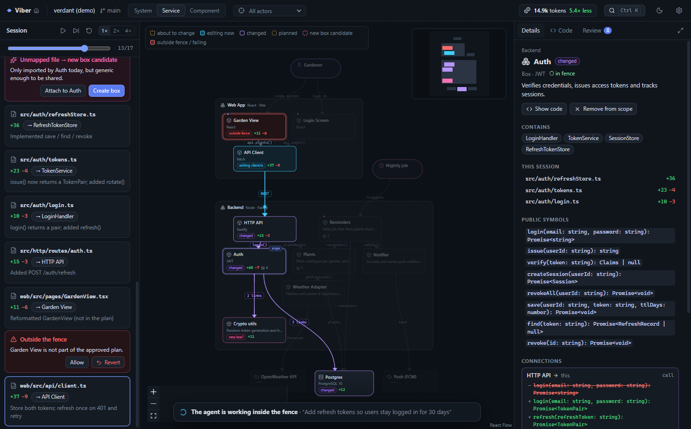
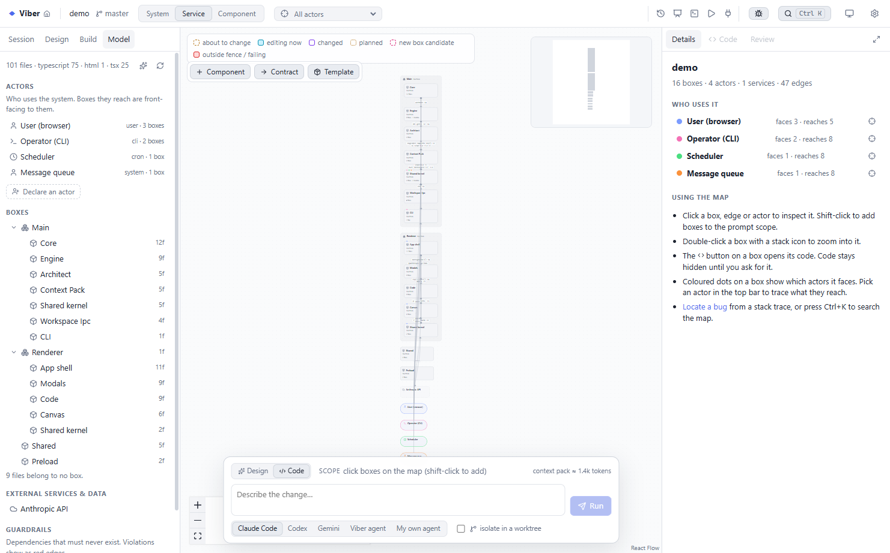
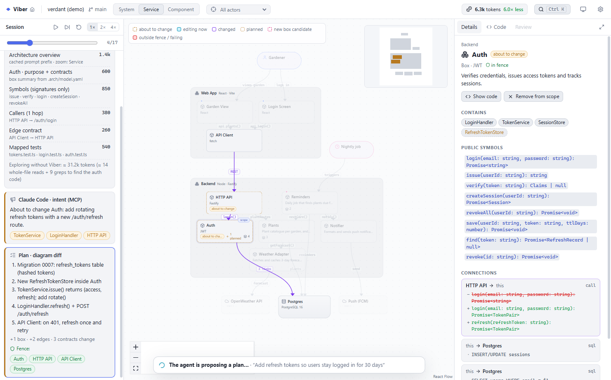
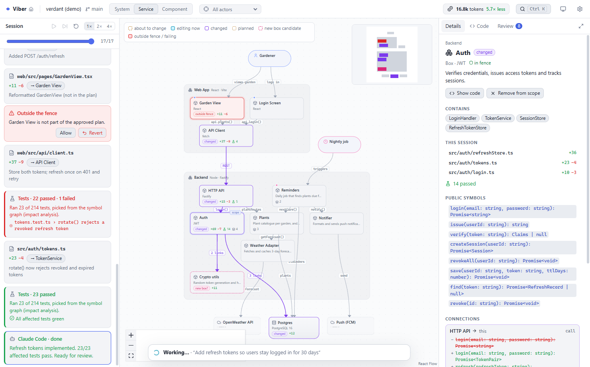
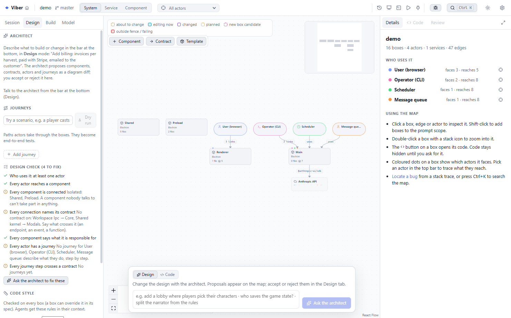

# Viber

**A visual-first IDE for vibe coders.** You work on a living architecture map of your repo, and AI agents write the
code. Code is something you drill into, not where you start.



Desktop app for macOS, Windows and Linux (Electron). Status: **early alpha**, built in the open. Expect rough edges.
Design notes: [docs/VISION.md](docs/VISION.md).

## Why

When agents write most of the code, you stop reading files line by line. You still need to know the shape of the
system: what the parts are, who uses them, what they promise each other, and what an agent is about to touch.
Viber makes that shape the main screen:

- **The map is the source of truth.** Boxes are components with one job, edges are contracts, and actors are the
  people and systems that use them. It's saved as `.arch/model.yaml` in your repo.
- **You set the direction, agents write the code.** Select boxes, describe a change, and pick Claude Code, Codex,
  Gemini, a local model, or your own tool.
- **Every edit shows up on the map.** Plans arrive as diagram diffs you approve. Edits outside the plan are flagged,
  and you review the result box by box.
- **Agents use fewer tokens.** Agents get a context pack for just the boxes in scope, plus tools that point them at the
  exact functions to change, so they don't have to grep the whole repo.

## A tour

### 1. Open a repo, get a map

Open any folder and click **Initialize**. Viber parses the code on your machine (nothing is uploaded) and proposes
components, contracts, external services and the actors who use them. You curate the draft and save it.



### 2. Prompt from the map, approve a plan

Select the boxes in scope, describe the change, and run an agent. Before it writes anything, the agent announces its
intent and proposes a plan as a diagram diff: new boxes, new edges, contract changes. The context it got (and what it
would have cost without Viber) is listed on the left.



### 3. Watch it work, review box by box

Each edit lights up its box. Files that don't belong to any box become *new box candidates*, edits outside the
approved plan are flagged *outside the fence* (allow or revert), and the tests affected by the change run on their own.
Then you review and commit one box at a time.



### 4. Design first

Starting from nothing? Describe the product to the **Architect** and it proposes components, contracts, actors and
journeys as a dashed preview on the map. The **design check** tells you what's still missing before anything gets
built, and the **Build** tab hands each planned box to an agent, providers first.



> The screenshots show the built-in demo session (**Try the demo session** on the welcome screen) and Viber opened on
> its own source code.

## Prerequisites

- Node.js 20+ and git.
- An agent to write the code, any of (subscriptions work, no API key needed for the first three):
  - [Claude Code](https://claude.com/claude-code) installed and signed in with your Claude plan (`claude`, then `/login`);
  - [Codex CLI](https://github.com/openai/codex) signed in with your ChatGPT plan (`npm i -g @openai/codex`, then `codex login`);
  - [Gemini CLI](https://github.com/google-gemini/gemini-cli) signed in with your Google account (`npm i -g @google/gemini-cli`, then run `gemini` once);
  - an Anthropic API key (Settings → Viber agent);
  - a local model through [Ollama](https://ollama.com) (e.g. `qwen3:14b`), LM Studio or vLLM. Free, slower.

## Run

```bash
git clone https://github.com/Mignastor/viber.git
cd viber
npm install
npm run dev
```

No agent set up yet? Click **Try the demo session** on the welcome screen to see a scripted run.

If `npm run dev` fails with `Electron uninstall`, npm skipped the Electron download:

```bash
node node_modules/electron/install.js
```

Other scripts: `npm test` (engine tests), `npm run typecheck`, `npm run dist:win | dist:mac | dist:linux` (installers;
build each on its own OS). On Linux, the terminal's `node-pty` compiles at install, so build tools (`make`, `g++`, `python3`) are needed.

## Start a new project

1. Create an empty folder, then **Open folder → Initialize**. Click **Set up git** in the top bar (agents need it for
   checkpoints, undo and parallel worktrees).
2. **Design tab → Architect:** describe the product ("a todo app: React frontend, FastAPI backend, SQLite").
   The proposal appears dashed on the map: components, contracts, actors, journeys. Accept, or edit the boxes by hand
   (*+ Component*, *Contract*, Inspector → Spec).
3. **Build tab:** Viber orders the planned boxes (providers first) and gives each one to an agent with its spec as the
   task. Autonomy per box decides whether you approve each plan.
4. Review box by box, then keep iterating from the map.

## Using it on an existing repo

1. **Open folder → Initialize.** Viber parses the repo locally (tree-sitter: TS/JS, Python, Go, Java, Kotlin, Rust,
   C#, PHP, Ruby, Swift, Vue/Svelte) and proposes:
   - **boxes that are components, not folders**:
     - level 1: deployable units (frontend, backend, worker);
     - below that: clusters of the dependency graph (Louvain), so each box is code that mostly talks to itself;
     - HTTP and CLI layers become their own components, and code used everywhere becomes a *Shared kernel*;
   - **edges with contracts**, from imports plus frontend `fetch` calls matched to backend routes;
   - **external services and data stores**, from known SDKs and URLs;
   - **actors**: who uses the system, inferred from UI pages, `/admin` routes, CLIs, schedulers, webhooks and queues.
2. **Curate the draft** in the Model panel (rename, merge, remove, accept), then **Save model**. This writes
   `.arch/model.yaml` (commit it) and `.arch/layout.json` (pinned positions).
3. **Declare actors** (Model panel → *Declare an actor*). Give a name and type, then pick the boxes they reach on the
   map or give route patterns like `/admin/*`. Boxes show coloured dots for the actors they face. *Facing: …* in the top
   bar highlights what one actor faces and everything it reaches.
4. **Prompt from the map.** Select boxes (the scope), describe the change, pick an agent, and press Run:
   - **Claude Code**, **Codex** or **Gemini**: runs that CLI headless with your plan, connected to Viber over MCP.
     Codex runs in its `workspace-write` sandbox; Gemini auto-approves edits but not shell commands (Viber runs the
     impacted tests itself). Nothing is written to your repo or CLI settings to connect them.
   - **Viber agent**: the built-in loop, using Claude via the API, or a local model through Ollama / vLLM / LM Studio.
   - **My own agent**: use Cursor, a terminal, anything. Viber watches the files and maps the work.

   The agent announces its intent and proposes a plan as a diagram diff, which you approve. Edits outside the plan
   are flagged, new folders become box candidates, impacted tests run, and you review and commit box by box.
   *Isolate in a worktree* runs the session on its own branch, so agents can work in parallel; merge or discard it after.
5. **Any edit, from any tool, lights up its box**: the *Changes on disk* session always watches the repo.

More tools:

- **Bug → box** (Ctrl+Shift+B): paste a stack trace or error, see the boxes and functions involved, and scope a fix.
- **Ctrl+K**: search boxes, routes, symbols and files. Results glow on the map.
- **Per-box rules**: conventions an agent gets only when that box is in scope.
- **Guardrails**: "A must never depend on B". Violations show as red edges.
- **Run panel**: run scripts. Stack traces turn their box red, request logs light up routes, and *Thumbnails* puts page
  screenshots on boxes. *Live preview* lets you Alt+click an element to jump to its box.
- **Runtime overlay**: send OpenTelemetry traces (OTLP/HTTP JSON) to `http://127.0.0.1:4318` to see real traffic per box
  and edge.
- **History**: a git-history heatmap per box. **Explain**: a walkthrough of what an actor reaches.
- **Connect agents** (plug icon): write `.mcp.json` and a CLAUDE.md / AGENTS.md section, so agents launched outside
  Viber use the map too. MCP URL: `http://127.0.0.1:7357/mcp`.
- **Describe with AI** (✦ in the Model panel): one-line purposes for boxes, cached by content hash. A local Ollama
  model works fine for this.

## Design and build (the map is the spec)

- **Design tab:**
  - Architect chat: describe what you want; it proposes components, contracts, actors and journeys as a diagram diff, previewed dashed on the map. Accept or reject.
  - Agents' questions pinned on boxes; an answer can become a rule on the box.
  - Journeys.
  - Drift between the design and the code.
- **On the map:**
  - *+ Component* adds a planned box.
  - *Contract* draws a designed dependency: click the consumer, then the provider.
- **Tech per box:** boxes talk through contracts, so each can use the language that suits its job when only agents
  write the code. Viber suggests one from the box's role, with the reason: UI → TypeScript + React; API and workers →
  the backend's language (else TypeScript); AI/data → Python; CPU-heavy compute → Rust; CLI → Go. The architect follows
  the same guide, and the build uses the suggestion when a box has no tech yet.
- **Inspector → Spec:** responsibility, what isn't its job, contract, acceptance criteria, status
  (planned → building → built → verified), autonomy (ask me / tell me / just do it).
  - **Typed contracts:** give a contract item an input/output (`{title, zone}`, `Plan[]`, `TaskCreate`) and Viber checks
    it against the code: handler parameters, Pydantic/TS model fields, `response_model` and return types, and function
    signatures. Each item shows ✓ matches, ✗ mismatch (with the difference) or ? unverified. Express/Hono handlers are
    read from their body (`req.body` fields, `res.json({...})` keys); router prefixes (`include_router`, `app.use`,
    `APIRouter(prefix=…)`) are applied. **Events and queues** are checked too: the box must publish what it promises,
    and once it declares events, any other topic it publishes is drift.
  - **Side effects:** Viber detects what each box does to the world (network, database, queue, files, subprocess,
    env vars, global state). Declare what a box may do; anything else is drift. Agents get the allow-list in their context.
  - **Code style:** max lines per function, max nesting, docstrings on public functions. Set the project default in the
    Design tab; a box can override it. Violations are drift, and agents get the rules in their context.
- **Templates:** the package button on a box exports it as a `.box` file (spec, rules, tech, what it needs from other
  boxes; shift-click to include the code). *Template* on the map imports one into another project.
- **Drift** lists the important things first (contract mismatches, undeclared effects). Undeclared routes and
  dependencies of a box fold into one row with *Add them to the contract / design*.
- **Build tab:** planned components become agent tasks generated from their spec, built providers-first in parallel worktrees.

## Agent tools (MCP and built-in agent)

| Tool | What it does |
|---|---|
| `where_to_change` | Ranked edit sites for a task: functions, line ranges, reasons, and the functions that usually change with them (git history) |
| `find_usages` | Every handler, caller and importer of a route or symbol; exact references from the bundled TypeScript and Python language servers |
| `read_symbols` | Read several functions in one call |
| `replace_symbol` | Rewrite a function by name |
| `arch_overview`, `arch_box` | The map and the box specs |
| `code_symbol`, `code_find`, `code_impact` | Look up a symbol, search, list affected tests |
| `propose_plan` | Propose a plan and wait for approval |
| `ask_human` | Ask a question pinned to a box |
| `record_decision` | Record a design decision on a box |
| `propose_contract_change` | Architectural Change Proposal: ask to change what a box offers; the agent waits, the edge turns dashed orange, and on approval the contract and designed edge update and consumers get follow-up tasks |
| `check_fence`, `locate_bug` | Check edit scope; map an error to boxes |

Safety nets for every agent: an edit that would leave a file unparseable is refused with the error position
(tree-sitter reparse); the type errors an edit introduces come back from the language server right away (TypeScript
and Python bundled, Rust and Go when rust-analyzer / gopls are installed); and when a file the agent read was changed
by someone else, the next tool result says so.

## Benchmark

Measures what Viber actually saves. Each task in a suite runs twice per agent:
- **baseline:** the agent alone, with a plain prompt and file tools;
- **viber:** the map tools, a context pack filtered to the task, and the scope.

Each run uses a fresh clone, then the task's checks (a command plus text that must or must not appear) decide pass or fail.

```bash
npm run build
VIBER_BENCH=bench/example.json npx electron .
```

The report (HTML + JSON) lands in `bench/results/`. It shows tokens (input, cached, output), cost when the agent
reports it, file reads, tool calls, pass rate and time. `bench/example.json` shows the format (put your own suites in `bench/local/`, which git ignores); it uses Claude Code; set `"agents": ["builtin"]`
plus `"settings"` to benchmark a local model instead.

### Edit-site benchmark

How well `where_to_change` predicts the files a real commit changed, from the commit message alone, next to a
keyword-grep baseline. Use a throwaway clone (it checks out old commits):

```bash
git clone --no-hardlinks <repo> /tmp/repo-history
npx tsx scripts/edit-site-bench.ts /tmp/repo-history 40
```

On 29 commits of a private FastAPI + React project: top-1 55%, top-3 93%, recall@5 81% (grep: 48%, 72%, 73%).

## Appearance

Dark and light themes: the sun/moon/monitor button in the top bar cycles **system → light → dark**.

## Layout

```
src/shared/          model, session event and IPC types shared by both processes
src/main/            Electron main process
  engine/            scan (tree-sitter, in a worker), resolve imports, group into boxes, detect, build model, YAML store
  workspace.ts       one open repo: defs + scan → model, curation ops, search, bug → box
  sessions.ts        watcher, git checkpoints, plan gate, reverts, contract diffs
  tools.ts mcp.ts    the agent tool surface and the MCP server (HTTP)
  agents.ts llm.ts   Claude Code runner, built-in agent loop, providers (Claude SDK, OpenAI-compatible)
  runner.ts runtime.ts preview.ts terminal.ts insights.ts git.ts settings.ts
src/renderer/src/    React UI: canvas (React Flow + ELK), panels, dialogs; sim/ holds the demo session + reducer
tests/               engine tests (vitest)
```

`VIBER_SNAP=steps.json VIBER_SNAP_OUT=dir npx electron .` (after `npm run build`) drives the app headlessly and saves
screenshots; see `src/main/devSnap.ts`.

## License

[Functional Source License 1.1, Apache 2.0 future license](LICENSE.md) (FSL-1.1-ALv2). You can use, modify and
share Viber for any purpose except offering a competing product or service; each release becomes Apache 2.0 two
years after it is published. Contributions: see [CONTRIBUTING.md](CONTRIBUTING.md).
